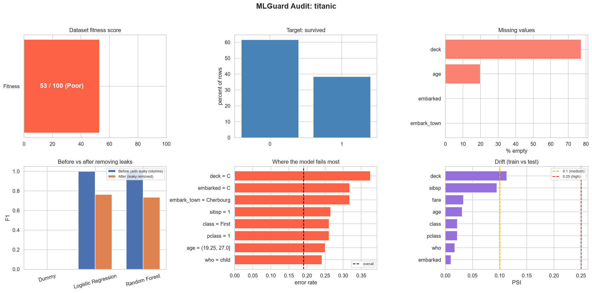
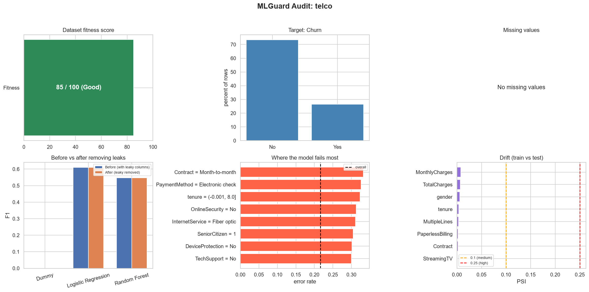
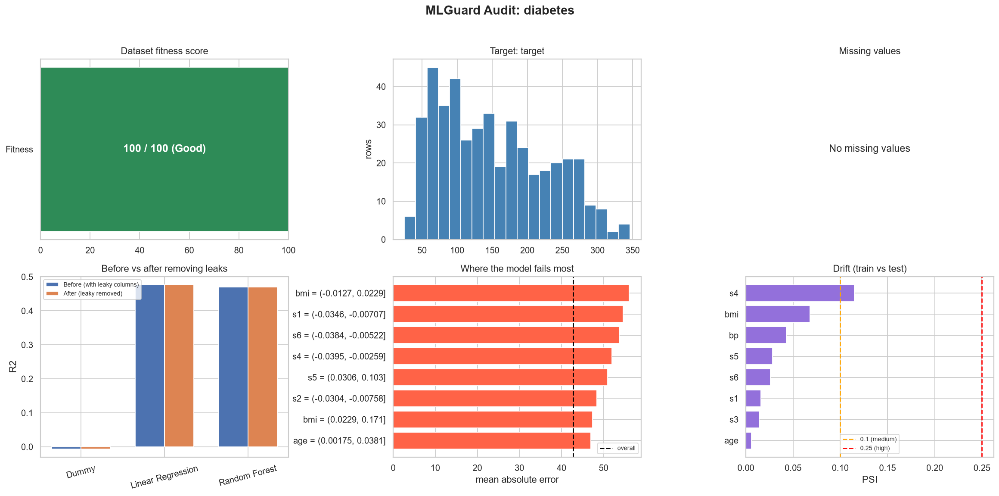

# MLGuard: Dataset and Model Audit Copilot

   

**MLGuard checks if a model score can be trusted.** Give it any CSV file and the target column. It audits the data and the model and writes a plain English report: what is wrong, how serious it is, and how to fix it.

## Why I built this

A high score is easy to get and hard to trust. A column can secretly contain the answer (data leakage), cells can be empty, or one class can be tiny. I wanted a tool that questions the score before we believe it. The best example is the Titanic dataset: one leaky column gives a perfect F1 of 1.00, and after removing it the honest score is about 0.75.

## What it does

- Detects classification or regression from the target column
- Checks data quality: missing values, duplicates, constant columns, numbers stored as text, outliers, class imbalance
- Finds data leakage with four checks: ID-like columns, high correlation, mutual information and a single-feature model test
- Gives a **fitness score (0 to 100)** with the reasons for lost points
- Trains a Dummy model, a simple model and a Random Forest, **before and after** removing leaky columns, with 5-fold cross-validation
- Finds the groups where the model fails most (the failure explorer)
- Checks drift between train and test with the KS test, category gaps and PSI
- Writes a report with severity (High, Medium, Low) and a fix for every issue, plus a 6-chart dashboard

No column name is hard-coded, so the same `audit(df, target)` call works on any dataset.

```python
results = audit(df, "Churn")                                  # run everything
show_report(results, name="telco", save_dir="images")         # report + dashboard
results = audit_csv("my_file.csv", "my_target_column")        # any CSV in one line
```

## A quick look



A line from the real Titanic report:

```
FITNESS SCORE: 53 / 100 (Poor)
1. [HIGH] Column 'alive' looks like leakage (alone predicts the target almost perfectly; ...)
      Fix: Remove it if it is not known at prediction time. If it is a real feature, keep it.
```

| Telco Churn | Diabetes |
|---|---|
|  |  |

## Results on 3 datasets

| Dataset | Task | Fitness | What MLGuard found | Model result |
|---|---|---|---|---|
| Titanic | Classification | **53 / 100** (Poor) | Leaky column `alive`, 107 duplicate rows, `deck` 77% empty | F1 **1.00 to 0.76** (Logistic) and **1.00 to 0.74** (Random Forest) after removing `alive` |
| Telco Churn | Classification | **85 / 100** (Good) | `TotalCharges` stored as text, ID column `customerID`, 26.5% churn | F1 0.61 (Logistic), 0.55 (Random Forest). The Dummy model has 73.5% accuracy but F1 = 0 |
| Diabetes | Regression | **100 / 100** (Good) | No major data problem | R2 0.48 (Linear), 0.47 (Random Forest) |

5-fold cross-validation (leaks removed): Titanic F1 0.760, Telco F1 0.599, Diabetes R2 0.478.
Drift: low on a random split. On a deliberately sorted split it becomes High (Titanic `age` PSI 6.05, Telco `tenure` 8.34), which shows the check works.

## How it works

```
CSV + target
   |
detect task -> data quality -> outliers + imbalance -> leakage detector
   |
fitness score -> baseline models (before / after) -> cross-validation
   |
failure explorer -> drift check -> findings (severity + fix) -> report + dashboard
```

MLGuard works on a copy and only reports (it never changes your data). Every function returns a dictionary or table, and each step runs in a safe wrapper, so one failing step does not stop the audit. 25 tests on synthetic data with known problems (a copied column, 60% missing values, duplicates, wrong input) check that it finds what it should. All 25 pass.

## What I learned

- Accuracy alone can mislead. A Dummy model gets 73.5% accuracy on Telco and still finds no churners.
- A very good score should be questioned first.
- Correlation misses text columns, so one check is never enough.
- Every threshold I picked is a simple rule, and a flag is a warning, not proof.

## How to run

```bash
git clone https://github.com/imankitcoder/MLGuard.git
cd MLGuard
python -m venv .venv
.venv\Scripts\activate          # Windows   (Mac/Linux: source .venv/bin/activate)
pip install -r requirements.txt
```

Open `MLGuard_Audit.ipynb` in VS Code or Jupyter, select the `.venv` kernel and run all cells. Titanic and Diabetes load automatically (Titanic needs internet once). The Telco audit takes about a minute because of cross-validation; use `audit(df, target, run_cv=False)` for a faster run.

## Limitations

- All limits (correlation 0.9, single-feature score 0.95, PSI 0.1 and 0.25, fitness points) are simple rules, not standards.
- Leaks made from several columns together are not found, and redundant columns (like `class` and `pclass`) are not reported.
- Drift is checked between a random train and test part, so real drift needs time-based or new data.
- Models use default settings (no tuning). Tested on 3 real datasets plus synthetic data.

## Next steps

- A Generative AI layer that explains the report in simple words
- Move the code into a Python package with a command line
- Detect redundant columns and leaks from column pairs
- Export the report as PDF or HTML

## Project files

```
MLGuard_Audit.ipynb   # the full project: functions, audit(), report, 25 tests
telco_churn.csv       # Telco dataset
images/               # dashboard screenshots
requirements.txt
.gitignore
```

## Development log

| Date | What was done |
|---|---|
| 19 Oct 2026 | Setup, data loading, data quality checks |
| 21 Oct 2026 | Leakage detector, fitness score, baseline models |
| 22 Oct 2026 | Before/after comparison, cross-validation, failure explorer, drift check |
| 25 Oct 2026 | `audit()`, plain English findings, report and dashboard |
| 26 Oct 2026 | Results summary table and 25 tests |

## Author

**Ankit**, data science learner from Bengaluru. Built with AI assistance as a mentor; I ran and tested every part and I can explain how each function works.
GitHub: [imankitcoder](https://github.com/imankitcoder)
